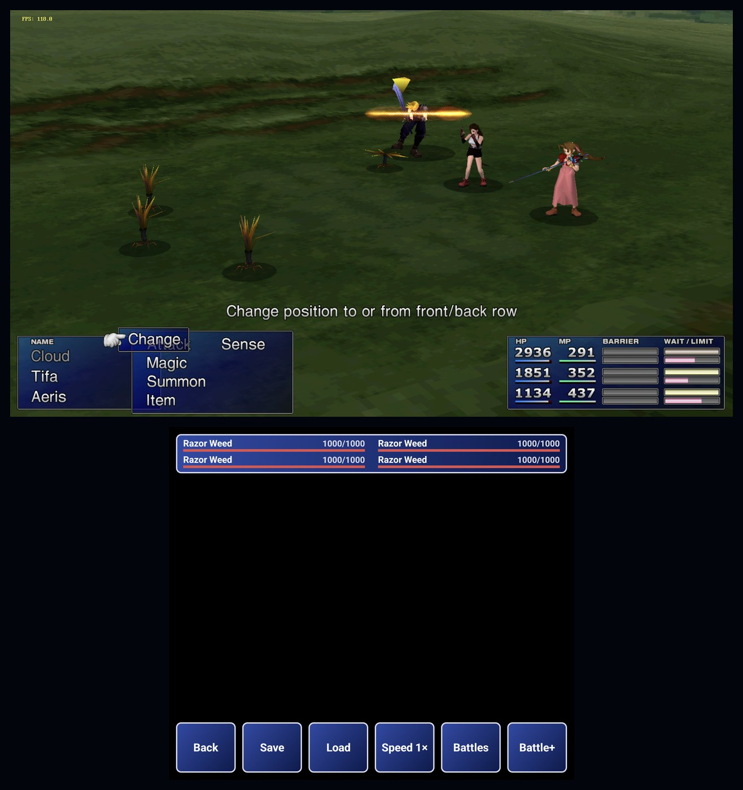
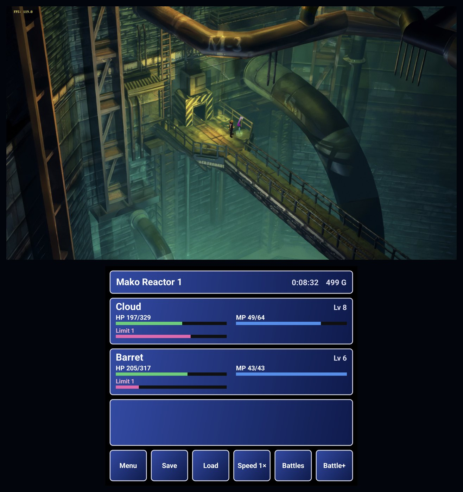
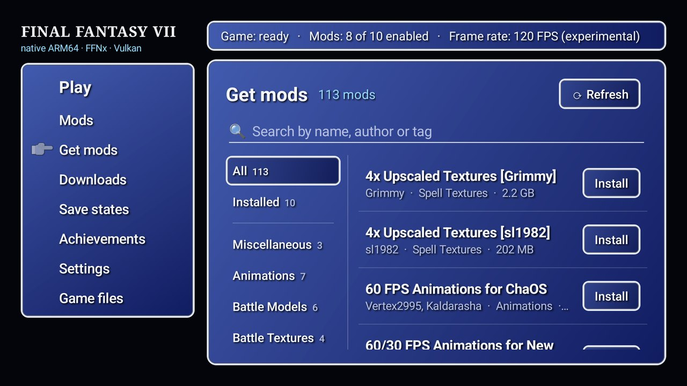
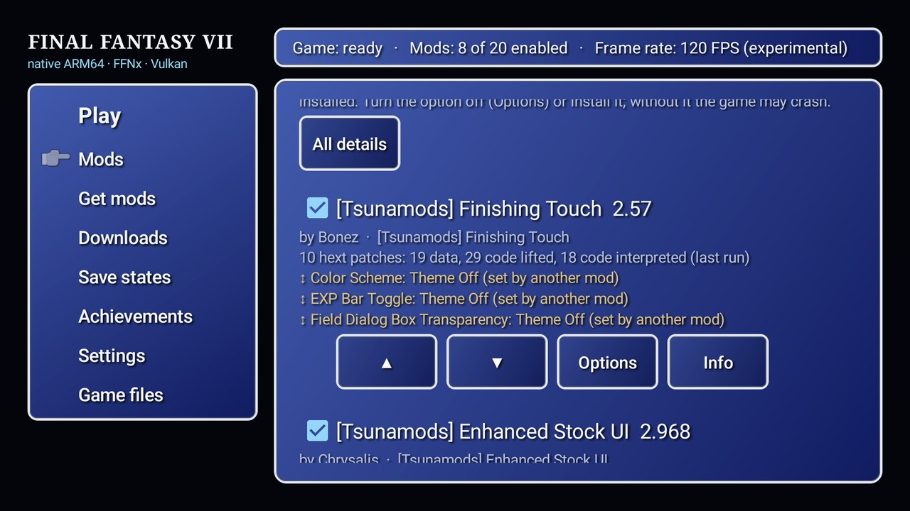
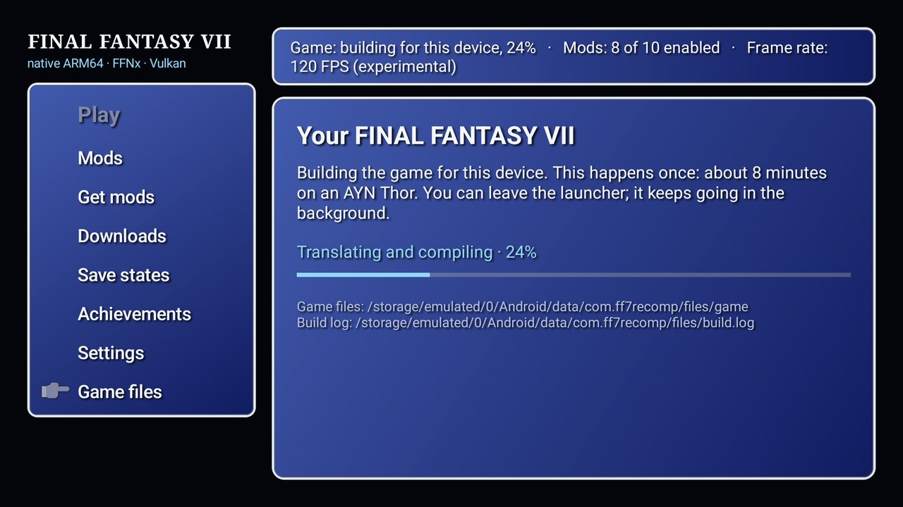
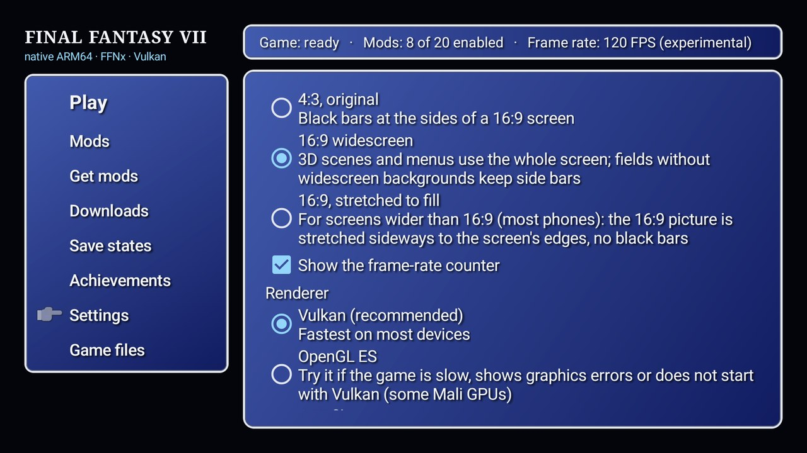

<p align="center"></p>

# FF7Recomp

FINAL FANTASY VII (PC, 1.02 US) statically recompiled to native ARM64 Android, rendered by
[FFNx](https://github.com/julianxhokaxhiu/FFNx) on Vulkan, with a 7th Heaven-style mod launcher.
Built for the AYN Thor (dual screen), and meant to run on other Android handhelds and phones.

> **This repository and the APK contain no game code or data.** You need your own copy of FINAL
> FANTASY VII (the Steam release). The app recompiles **your** `ff7_en.exe` on your device, once;
> nothing derived from the game is ever published here.
> Not affiliated with or endorsed by Square Enix. FINAL FANTASY is a trademark of Square Enix.



## Made with AI

**This project was built with AI, start to finish.** I wanted a working way to play a modded
FF7 on my AYN Thor, and over a weekend I directed an AI coding agent (Anthropic's Claude, in
Claude Code) to build it. The AI wrote essentially all of the code here: the recompilation
pipeline, the Android port of FFNx, the launcher, the on-device build and these docs. My part
was deciding what to build, testing every step on the Thor, and saying what worked and what
did not. Commits are credited to Claude for that reason.

I know AI-written code is a real point of contention, so here it is up front:

- **It has not been reviewed line by line by an experienced human developer.** It works on my
  Thor: the game boots, plays and runs mods, but expect rough edges and bugs.
- **The hard parts were built by people.** FFNx, pcrecomp and nfsu2-recompiled, 7th Heaven,
  bgfx, and every mod in the catalogs are human work that this project stands on (see
  [Credits](#credits-and-licenses)). Please support those projects.
- **I am making it public to improve it,** and so people can play it. Bug reports, testing on
  other devices, reviews and fixes are all welcome, from people and from people using AI tools.

If AI-made software is not something you want to run or contribute to, that is a fair choice,
and I would rather you know before you install it.

## What you get

- The game running natively (no emulation, no Wine/FEX), at 30, 60 or 120 FPS.
- A launcher: import your game files, browse and install mods from the 7th Heaven catalogs
  (.iro, .zip, .7z), set mod order and options, settings, save states, achievements. It plays
  FF7's own menu sounds (or your mods' versions of them).
- 16:9 widescreen, controller support (A confirms, B cancels), save states.
- On the AYN Thor's bottom screen: party status, location, enemy HP in battle, a touch deck
  (menu, save/load state, speed, random battles, battle enhancement); it dims during cutscenes.
- Game boosters as in the console re-releases (speed, no random battles, battle enhancement).
- Steam achievements on your own Steam account (see [Steam achievements](#steam-achievements)),
  and a local achievement set (RetroAchievements format; offline only).

## Screenshots

| | |
|---|---|
|  |  |
| **Dual screen: field** | **Dual screen: battle** |
|  |  |
| **Get mods** | **Your mods** |
|  |  |
| **First run: building the game on the device** | **Settings** |

## Playing

1. Download the APK from [Releases](../../releases/latest) and install it (allow installing
   from your browser or file manager when Android asks).
2. Put your FINAL FANTASY VII install folder from Steam on the device (internal storage, an SD card
   or a USB drive): the folder that contains `ff7/resources/ff7_1.02/ff7_en` and
   `ff7/workingdir/data`.
3. Open FF7Recomp → **Game files** → **Find my FF7 folder…** and pick it.
4. The launcher copies the game files, then builds the game for your device: it translates your
   `ff7_en.exe` to C, compiles it with the clang it carries and links it with the engine (FFNx,
   the renderer, the runtime). This happens once; on an AYN Thor it takes about 8 minutes and
   carries on in the background (a notification shows the progress). **Quiet build** halves the
   speed to keep the fan low.
5. Press **Play**.

Only the Steam release's 1.02 US `ff7_en` is supported; the launcher checks it before building.

**FF7 downloaded with GameNative?** GameNative keeps games in its private internal storage by
default, which other apps cannot read. Turn on GameNative's external storage (SD card) option and
pick `GameNative/Steam/steamapps/common/FINAL FANTASY VII` on the card, or copy the folder from a PC.

### Bringing your PlayStation saves

**Save states** → **Import PlayStation saves…** takes a PS1 memory card: DuckStation (`.mcd`),
ePSXe (`.mcr`), RetroArch (`.srm`), DexDrive (`.gme`) or PSP (`.vmp`). Its FF7 saves go into a new
save file (Save 2, Save 3… under **Continue**), so none of yours are overwritten. DuckStation keeps
its cards in `Android/data/com.github.stenzek.duckstation/files/memcards`; copy the card somewhere
you can pick it, such as Download, first.

## Building the APK

The APK is built on **Windows** (Git Bash) and needs no game files.

### 1. Install the tools

| Tool | Notes |
|---|---|
| [Git for Windows](https://git-scm.com/download/win) | provides Git Bash |
| [Python 3](https://www.python.org/downloads/) | |
| [Android Studio](https://developer.android.com/studio) or the command-line SDK | SDK Manager → SDK Tools: **NDK (Side by side) 28.2.13676358**, **CMake 3.30.5**, Android SDK Platform-Tools |
| JDK 17 | Android Studio's bundled JBR works, or [Microsoft OpenJDK 17](https://learn.microsoft.com/java/openjdk/download) |
| [LLVM for Windows](https://github.com/llvm/llvm-project/releases) | clang for build-time host tools |
| [Visual Studio 2022 Build Tools](https://visualstudio.microsoft.com/downloads/) | "Desktop development with C++" (bgfx's shader compiler, LLVM's tablegen) |

`tools/env.sh` finds these in their standard install locations. If yours are elsewhere, set
`ANDROID_SDK_ROOT`, `JAVA_HOME`, `LLVM_DIR` or `MSBUILD`.

### 2. Build

In Git Bash:

```bash
git clone <this repository> FF7Recomp
cd FF7Recomp
bash tools/build_all.sh
```

`build_all.sh` runs every step in order: the pinned toolkits (pcrecomp, FFNx, bgfx) and their
patches, the libraries, FFmpeg, shaders, the on-device build kit (clang and lld built for Android,
about 40 minutes the first time; Python for Android; the lifter; the engine's prebuilt archives)
and the APK. If a step fails, fix the cause and run it again; finished steps are skipped.

The APK ends up in `android/app/build/outputs/apk/debug/app-debug.apk`.

`config/catalog.json.gz` (the function boundaries of the 1.02 exe: addresses only) and
`config/ffnx_manifests/` (FFNx's patch sites) come from the game's exe and are made on a PC that
has it, with `tools/run_lift.py catalog` and `tools/refresh_manifests.sh`.

## Mods

**Get mods** lists the Qhimm and Sega 7th Heaven catalogs. Install, then enable and order them
under **Mods** (higher in the list wins). Large mods download and unpack on the device; you
can keep using the launcher meanwhile. You can also add your own `.iro` files or mod folders.

## Steam achievements

**Achievements** → **Sign in with the Steam app…** shows a QR code: scan it in the Steam mobile
app (Steam Guard → Scan a QR code) and approve. You never type your Steam password into
FF7Recomp; it keeps only Steam's sign-in token, in its private storage. **Sign out** removes it.

FFNx's own achievement code decides when one is earned, exactly as it does on PC; FF7Recomp
sends it to your Steam account (the FINAL FANTASY VII you own on Steam: the current release or
the 2013 one, each with its own list). Unlocks show in game and as a notification, and are sent
at once when online, or the next time you are. While it talks to Steam, your Steam profile may
briefly show you playing FINAL FANTASY VII.

## Reporting problems

Please open an issue with your device, Android version, the mods you have enabled, and what
happened. Logs are in `Android/data/com.ff7recomp/files/`: `ff7.log`, `build.log` (the first-run
build) and `game/FFNx.log`.

## Known limitations

- Only the Steam release's 1.02 US exe (`ff7_en`) is supported.
- Movies decode on the CPU (no hardware decoding yet): upscaled 30 FPS movie mods work on the
  Thor but run warmer.
- The 120 FPS mode is experimental.
- RetroAchievements: offline only, until the port is approved by RetroAchievements.
- Steam achievements: tested with "First Blood" on the current release; the others use FFNx's
  triggers unchanged but have not each been played through here. Steam playtime and cloud saves
  are not synced.

## Credits and licenses

FF7Recomp is GPL-3.0 (it links FFNx). It builds on:
[pcrecomp](https://github.com/sp00nznet/pcrecomp) (MIT),
[nfsu2-recompiled](https://github.com/codepdbh/nfsu2-recompiled) (MIT; Android host),
[FFNx](https://github.com/julianxhokaxhiu/FFNx) (GPL-3.0),
[bgfx/bx/bimg](https://github.com/bkaradzic/bgfx) (BSD-2),
[7th Heaven](https://github.com/tsunamods-codes/7th-Heaven) (MS-PL; mod formats),
[rcheevos](https://github.com/RetroAchievements/rcheevos) (MIT),
the [LZMA SDK](https://www.7-zip.org/sdk.html) (public domain),
[FFmpeg](https://ffmpeg.org/) (LGPL).
The APK also carries, for the on-device build: [LLVM/clang and lld](https://llvm.org/) (Apache-2.0
with LLVM exceptions), [Python for Android](https://www.python.org/downloads/android/) (PSF),
[Capstone](https://www.capstone-engine.org/) (BSD-3) and [pefile](https://github.com/erocarrera/pefile) (MIT).
For Steam achievements: [JavaSteam](https://github.com/Longi94/JavaSteam) (MIT) with its libraries
(protobuf, BSD-3; OkHttp, Ktor and Kotlin, Apache-2.0; Commons Lang, Apache-2.0) and
[ZXing](https://github.com/zxing/zxing) (Apache-2.0) for the QR code.
